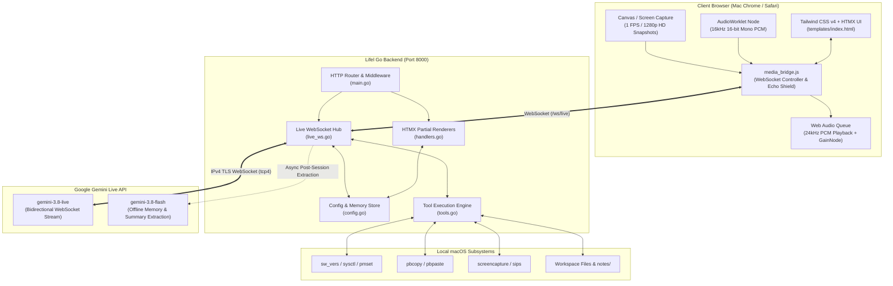
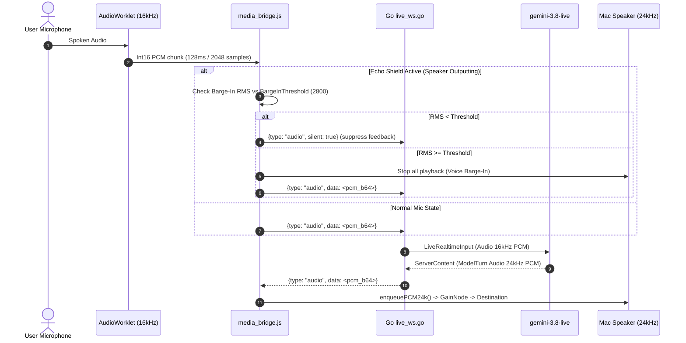

# Lifel — System Architecture & Design Specification

Lifel is an ultra-low latency, bidirectional real-time voice, vision, and local tool workbench built natively in **Go** and **Web standards (HTMX + Web Audio API + Tailwind CSS v4)**. It interfaces with Google's **Gemini 3.8 Live (`gemini-3.8-live`)** bidirectional multimodal model and **Gemini 3.8 Flash (`gemini-3.8-flash`)** for memory extraction and tool verification.

---

## 1. High-Level System Architecture



---

## 2. Core Architectural Pillars

### 2.1 Single-Binary Native Performance
- The entire backend is written in standard **Go**, compiling into a single self-contained binary (`./lifel`).
- No Python runtime, Node.js daemon, or external service dependencies are required at runtime.
- Startup latency is under **15 milliseconds**, with built-in stale process reaping (`pgrep -x lifel` and `lsof -ti :8000`).

### 2.2 Forced IPv4 Outbound Dialing (`tcp4`)
To eliminate connection dropouts (`read tcp ...:443: read: no route to host`) caused by ISP IPv6 route flapping (frequent across Southeast Asian ISPs like Telkom Indonesia / IndiHome), the Go WebSocket dialer overrides `NetDialContext`:
```go
websocket.DefaultDialer.NetDialContext = func(ctx context.Context, network, addr string) (net.Conn, error) {
    return stdDialer.DialContext(ctx, "tcp4", addr)
}
```
All outbound WebSockets to `generativelanguage.googleapis.com` are strictly pinned to Google's IPv4 edge network.

### 2.3 Dual-Layer Session Resumption
Session continuity operates across two complementary layers:
1. **Google Native Resumption**: `SessionResumptionConfig{ Handle: cfg.LastResumptionHandle }` transmits the server resumption token upon reconnection. Note that `Transparent: true` is omitted because it is restricted to Gemini Enterprise Agent Platform mode and causes handshakes to fail under the Gemini Developer API.
2. **Dual-Layer Context Fallback**: If Google's live server rejects an expired handle or resets the session, Lifel automatically retrieves the turns from the last session record (`sessions/*.json`) and injects them into Gemini's system instruction, guaranteeing conversational memory across reloads and unexpected drops.

---

## 3. Data Pipelines & Protocols

### 3.1 Real-Time Audio Pipeline



- **Input Sample Rate**: `16,000 Hz`, 16-bit Mono PCM.
- **Chunk Size**: `128 ms` (`2048` samples per buffer), adhering to Google's real-time input specifications.
- **Output Sample Rate**: `24,000 Hz`, 16-bit Mono PCM, scheduled seamlessly via Web Audio API `AudioBufferSourceNode` timestamps.
- **Echo Shield & Barge-In**: An intelligent half-duplex suppression shield with dynamic voice barge-in and a rolling 3-chunk (~384ms) PCM pre-roll buffer. While audio is playing through Mac speakers, mic frames are suppressed unless the user speaks louder than the configured `barge_in_threshold` (default: `600` RMS). Upon speech onset, speaker playback is immediately killed, cooldown is reset, and the buffered pre-roll audio is flushed to Gemini Live so opening consonants/words ("Wait", "Can you", "1, 2") are never clipped.

---

### 3.2 Vision & Multimodal Frame Ingestion

1. **Continuous Video Streaming**: Camera or screen frames captured at 1 FPS via HTML5 `<video>` and rendered to an offscreen `<canvas>`.
2. **Resolution Tiering**: Configurable between `640p` (fast preview), `1080p` (standard), and `1280p` (crisp code/text inspection).
3. **On-Demand HD Snapshot Injection**:
   - The user or assistant can trigger an HD frame snapshot.
   - When Gemini calls `capture_mac_screen`, the server executes native macOS `screencapture -x -t jpg` and `sips -Z 1280`, injecting the full desktop display JPEG directly into the live session stream.

---

### 3.3 Tool Execution & Function Calling

Lifel exposes **12 local macOS and multi-source web tools** to the model:

| Tool Name | Scope | Purpose |
| :--- | :--- | :--- |
| `get_mac_system_info` | System | Battery percentage, CPU load, RAM, free disk space, macOS version, local time. |
| `web_search` | Web | Multi-source search: DuckDuckGo HTML, Google News RSS, Wikipedia EN & ID. |
| `read_webpage` | Web | Clean article text extractor stripping scripts, styles, and boilerplate HTML. |
| `save_user_memory` | Memory | Saves durable facts, preferences, or tasks to persistent `memory.json`. |
| `search_user_memory` | Memory | Searches and filters saved facts in the user's persistent memory bank. |
| `list_project_files` | Workspace | Lists directory trees within the workspace boundary. |
| `read_project_file` | Workspace | Reads workspace files (strictly prevents `.env` leakage and path traversal). |
| `write_project_note` | Workspace | Appends or writes markdown notes inside `notes/`. |
| `calculate_math` | Utility | Recursive-descent math parser supporting trigonometry, roots, powers, logs. |
| `mac_clipboard` | System | Reads (`pbpaste`) or writes (`pbcopy`) to macOS clipboard. |
| `open_url_or_app` | System | Opens URLs in default browser, reveals workspace files, or launches Mac apps. |
| `capture_mac_screen` | Vision | Captures desktop via `screencapture` or requests browser HD frame. |

#### Function Calling Flow
1. Gemini Live issues a `ToolCall` containing `FunctionCalls`.
2. The server dispatches the tool locally via `executeLocalTool()`.
3. Client UI receives real-time collapsible tool inspection cards (`type: "tool_call"` and `type: "tool_result"`).
4. Results are serialized into `genai.FunctionResponse` and sent back to Gemini using `session.SendToolResponse()` with scheduling mode `FunctionResponseSchedulingWhenIdle`.

---

## 4. Storage & Persistence Layout

```
lifel/
├── main.go                     # Server bootstrapper, process reaper, static file server, logging
├── live_ws.go                  # Live WebSocket bridge, audio I/O, Gemini SDK session, session resumption
├── handlers.go                 # HTTP & HTMX routes, partial HTML renderers, REST APIs
├── tools.go                    # 12 Local Mac tools, web search scrapers, math parser
├── config.go                   # Config manager, memory bank, session history, notes storage
├── handlers_test.go            # Automated HTTP & HTMX endpoint test suite
├── tools_test.go               # Automated tool execution & security test suite
├── templates/
│   └── index.html              # Tailwind CSS v4 + HTMX workbench UI
├── static/
│   └── media_bridge.js         # Hardware audio worklet, VAD, WebRTC, WebSocket client
├── notes/                      # User & assistant markdown notes (git-ignored)
├── sessions/                   # JSON & Markdown conversation history records (git-ignored)
├── config.json                 # Local configuration overrides (git-ignored)
├── memory.json                 # Persistent user memory bank (git-ignored)
└── .env                        # Gemini API key slots (GEMINI_API_KEY_1..5) (git-ignored)
```

---

## 5. Security & Isolation Boundaries

- **Workspace Path Sandboxing**: All file inspection tools (`list_project_files`, `read_project_file`, `write_project_note`) validate paths against `baseDir` using `filepath.Clean()` and `strings.HasPrefix()`. Traversal attacks (`../../etc/passwd`) are blocked.
- **Credential Protection**: The `.env` file and API keys are blocked from `read_project_file`. Keys are never leaked to client transcripts.
- **Network Safety**: Web searching avoids headless browser automation, utilizing lightweight, sandboxed HTTP requests with strict timeouts (`5s`).

---

## 6. Model Specification Matrix

| Task | Target Model | API Endpoint | Notes |
| :--- | :--- | :--- | :--- |
| Real-Time Spoken Interaction | `gemini-3.8-live` | Gemini Live WebSocket (`v1alpha`) | Bidirectional audio & vision streaming |
| Post-Session Memory Extraction | `gemini-3.8-flash` | Gemini GenerateContent | Runs asynchronously on disconnect |
| API Key Health Verification | `gemini-3.8-flash` | Gemini GenerateContent | Low-latency ping test |
