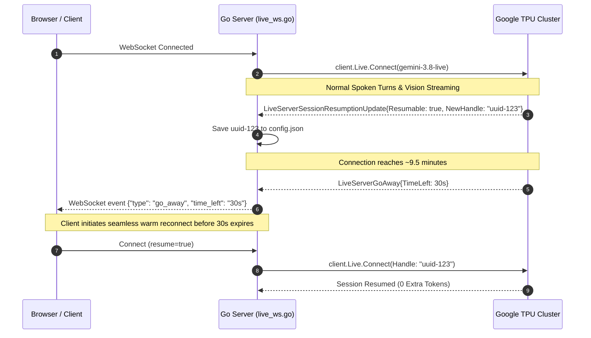

# Comprehensive Context Management Architecture in Lifel

This document specifies the complete, authoritative architecture of **Context Management**, **KV-Cache Lifecycles**, **System Instruction Assembly**, **Session Resumption**, **Tool Response Scheduling**, and **Autonomous Memory Distillation** in Lifel. It reflects the production implementation powered by Google's **Gemini Multimodal Live API (`BidiGenerateContent`)** via the `google.golang.org/genai` Go SDK.

---

## 1. Executive Overview & The Jarvis Architecture

Lifel is engineered as an **omnipresent, personal AI operating assistant for macOS** inspired by the Jarvis archetype:
* **Single High-Speed Loop**: Lifel operates as a single, ultra-responsive multimodal loop. By avoiding bloated sub-agent orchestration trees, Lifel minimizes turn latency to sub-100ms, avoids context multiplication, and delivers immediate, conversational voice-and-vision pairing.
* **Dual-Engine Operation**:
  1. **Real-Time Multimodal Live Engine (`gemini-3.8-live`)**: Handles continuous bidirectional 16kHz audio, 1080p camera/screen vision frames, native macOS tool executions, and sub-100ms conversational audio output over a stateful WebSocket.
  2. **Asynchronous Memory Distillation Engine (`gemini-3.5-flash-lite` cascade)**: Operates entirely out-of-band upon call termination. It consolidates durable memories, resolves factual contradictions, and updates a rolling session summary without imposing token or latency overhead on live calls.

```
┌────────────────────────────────────────────────────────────────────────────────────────┐
│                                 LIFEL ARCHITECTURE                                     │
├────────────────────────────────────────────────────────────────────────────────────────┤
│                                                                                        │
│   ┌────────────────────────────────────────────────────────────────────────────────┐   │
│   │                      MULTIMODAL LIVE LOOP (WebSocket)                          │   │
│   │                                                                                │   │
│   │   User Mic (16kHz PCM) ────┐                                                   │   │
│   │   Webcam / Screen (1-2fps) ┼──► [Go Server: live_ws.go] ──► Gemini 3.8 Live    │   │
│   │   Mac System Tools (13)   ──┘             │                         │          │   │
│   │                                           │                         ▼          │   │
│   │   Browser Speaker (24kHz)  ◄──────────────┴─────────────── Spoken Audio / TTS │   │
│   └────────────────────────────────────────────────────────────────────────────────┘   │
│                                           │ (On Disconnect)                            │
│                                           ▼                                            │
│   ┌────────────────────────────────────────────────────────────────────────────────┐   │
│   │                  BACKGROUND MEMORY CONSOLIDATION CASCADE                       │   │
│   │                                                                                │   │
│   │   Raw Session Turns  ──► [extractMemoriesAndSummary()] ──► Gemini Flash Cascade │   │
│   │                                       │                     (3.5-lite -> 3.8)  │   │
│   │                                       ▼                                        │   │
│   │                     Contradiction Resolution & Dedup                           │   │
│   │                                       │                                        │   │
│   │                                       ▼                                        │   │
│   │                     memory.json (Capped at 25 Facts)                           │   │
│   └────────────────────────────────────────────────────────────────────────────────┘   │
│                                                                                        │
└────────────────────────────────────────────────────────────────────────────────────────┘
```

---

## 2. Gemini Live Multimodal Context: The TPU KV-Cache

In traditional REST APIs (e.g. `generateContent`), the client transmits the entire conversation history on every request, paying quadratic attention and serialization penalties.

In the **Gemini Multimodal Live API (`BidiGenerateContent`)**, context is an **active, server-side Key-Value (KV) attention cache**:
1. **Stateful In-Memory Session**: Once the connection opens via `client.Live.Connect()`, Google's TPU cluster allocates a dedicated KV-cache for the connection.
2. **Streaming Token Ingestion**: Every millisecond of 16kHz audio, every 1080p camera/screen frame, and every tool result appends directly to this server-side cache.
3. **Multimodal Cross-Attention**: Audio waveforms and visual embeddings reside in the same attention space, enabling Gemini to ground spoken pronouns (*"What is that chip on the breadboard?"*) in the visual frame streamed 500ms earlier.

### Live Token Rates on the Wire
| Stream Channel | Token Generation Rate | Engineering Implication |
| :--- | :--- | :--- |
| **User Mic (16kHz PCM)** | $\sim 25\text{--}35\text{ tokens/sec}$ | Ingested via `SendRealtimeInput` as raw PCM chunks. |
| **Vision (Webcam / Screen)** | $\sim 258\text{ tokens/frame}$ | Ingested at 1.0–2.0 FPS as 1080p JPEG blobs. |
| **Gemini Spoken Voice** | $\sim 30\text{ tokens/sec}$ | Converted directly to 24kHz PCM audio output. |
| **Native Tool Execution** | $\sim 80\text{--}500\text{ tokens/call}$ | Call arguments + JSON response payload. |

---

## 3. Official Gemini Live API Specifications vs. Lifel Architecture

To maintain a production-grade harness, Lifel strictly adheres to the official wire protocol of `google.golang.org/genai`:

| Capability / Concept | Common Misconception | Actual Gemini Live API Wire Behavior | Lifel Production Implementation (`live_ws.go`) |
| :--- | :--- | :--- | :--- |
| **Warm Resumption TTL** | "Resumption handles expire in 5–15 minutes." | **Socket lifetime is $\sim 10$ minutes**, but **Resumption Handles are valid for 2 hours** after session termination. | Resumes via `SessionResumptionConfig{Handle: lastHandle}` up to 2 hours after disconnection at 0 extra tokens. |
| **Resumption Update Handling** | "Always save `NewHandle` whenever update arrives." | `SessionResumptionUpdate` includes `Resumable bool` and `NewHandle string`. `NewHandle` is **empty** when `Resumable == false`. | Checks `update.Resumable && update.NewHandle != ""` before saving to avoid overwriting valid handles with `""`. |
| **Long Session Continuity** | "30-minute calls stay on 1 WebSocket." | Single WebSocket connections drop at $\sim 10$ minutes with an `ABORTED` code. Server sends `GoAway` first. | Listens for `resp.GoAway != nil` with `TimeLeft`, broadcasts warning, and prepares warm auto-rotation. |
| **Cold Session Resumption** | "Inject 20 old turns into System Instruction." | `SystemInstruction` is **permanently protected from Sliding Window eviction**, making old turns uncompressible. | Seeds historical turns into the mutable KV-cache via `session.SendClientContent` with `TurnComplete: false`. |
| **Bilingual Speech-to-Text** | "STT is configured via text in System Prompt." | `gemini-3.8-live` processes audio natively; transcripts are enabled via `InputAudioTranscription` configs. | Configured via `LiveConnectConfig.RealtimeInputConfig` and `OutputAudioTranscription`. |
| **Tool Response Scheduling** | "Gemini always pauses until tools return." | Live API supports `WHEN_IDLE`, `INTERRUPT`, and `SILENT` scheduling. | Uses `SILENT` for `save_user_memory` so memory is absorbed without audibly interrupting the speaker. |
| **Interrupted Tool Calls** | "Tools always execute to completion." | When a user barges in mid-tool call, Google sends `LiveServerToolCallCancellation` with cancelled IDs. | Listens for `resp.ToolCallCancellation`, logs cancelled IDs, and suppresses stale responses. |

---

## 4. Handshake Payload Anatomy ($t = 0$)

When you click **Connect**, Lifel constructs the initial `genai.LiveConnectConfig`. Before any microphone audio is streamed, Google receives two primary blocks that form the **Base Context**:
1. **The System Instruction** ($\approx 750\text{--}850\text{ tokens}$)
2. **The 13 Native Tool Function Declarations** ($\approx 1,250\text{ tokens}$)

```
Initial Context Baseline: ~2,050 - 2,100 Tokens (Immutable Anchor)
```

### The 4-Layer System Prompt Architecture (`config.go`)

The System Instruction is assembled dynamically by `buildFullSystemPrompt()` into 4 clean, focused layers:

```
┌────────────────────────────────────────────────────────────────────────────────┐
│ Layer 1: Jarvis Persona & Core Conversational Rules                            │
├────────────────────────────────────────────────────────────────────────────────┤
│ Layer 2: Spoken Response Style Directive ([RESPONSE STYLE: CONCISE], etc.)    │
├────────────────────────────────────────────────────────────────────────────────┤
│ Layer 3: Runtime Operating Context (Clean macOS, Time, Timezone Awareness)     │
├────────────────────────────────────────────────────────────────────────────────┤
│ Layer 4: Persistent User Memory Bank (Injected from memory.json, max 25 items) │
└────────────────────────────────────────────────────────────────────────────────┘
```

#### Verbatim Example of System Instruction Sent to Google:

```text
You are Lifel, an advanced Jarvis-like personal AI operating assistant running natively on the user's Mac. Always respond in the same language the user speaks (English or Indonesian). Keep your spoken answers crisp, natural, direct, and intelligent with zero conversational fluff. When asked to perform actions, check Mac status, search the live web, inspect files, capture the screen, or save notes and memories, execute the appropriate tools proactively and smoothly.

[RESPONSE STYLE: CONCISE] Keep spoken answers brief (1 to 2 sentences by default) unless the user asks for a deep explanation.

=== RUNTIME OPERATING CONTEXT ===
- Assistant Name: Lifel (Omnipresent Personal Operating Assistant)
- Platform & Hardware: macOS Apple Silicon (darwin/arm64)
- Local Date & Time: 2026-11-08 20:30:00 (Sunday)
- Primary Location & Timezone: Asia/Jakarta (WIB) / User Local Time
- Active Voice Profile: Charon
- Custom Vocabulary & Domain Terms: Lifel, Gemini 3.8 Live, Samsung Innovation Campus, Indonesia, MacBook Air, Golang, HTMX, Tailwind CSS, KiCad, ESP32
- Enabled Native Tools (13): get_mac_system_info, web_search, read_webpage, crawl_website, save_user_memory, search_user_memory, list_project_files, read_project_file, write_project_note, calculate_math, mac_clipboard, open_url_or_app, capture_mac_screen
- Operating Directive: Act like Jarvis—proactive, razor-sharp, helpful, and concise. Never leak internal API keys, slot names, or low-level web framework details.
================================

=== PERSISTENT USER MEMORY BANK ===
- [PINNED] [SUMMARY] Last session (20261108_190000): User finalized hardware telemetry and verified memory consolidation.
- [PINNED] [PREFERENCE] User prefers direct, concise, practical answers with zero AI slop.
- [PINNED] [USER] User works on macOS (Apple Silicon) in the local project workspace.
- [PROJECT] Developing robotics perception pipeline with ESP32 and KiCad hardware.
===================================
```

---

## 5. System Prompt Hygiene & Secret Protection

Lifel enforces strict **System Prompt Hygiene**:
1. **No Internal Secret Leaks**: Active key slot aliases (such as `GEMINI_API_KEY_5`), API tokens, or environment variable identifiers are **never** injected into the LLM system prompt.
2. **No Implementation Clutter**: Go compiler versions (`go1.24.0 darwin/arm64`) and web stack names (`HTMX`, `Tailwind CSS`) are excluded from general voice sessions. Feeding infrastructure secrets into every call wastes baseline tokens and causes "meta-slop" where the voice assistant unnecessarily mentions its tech stack.
3. **Protected Sliding-Window Isolation**: Historical session turns are **never** injected into Layer 5 of `SystemInstruction`. Because `SystemInstruction` is permanently protected from server-side eviction, putting 20 turns of past dialogue in the system prompt makes stale history immortal and causes hallucinations (e.g., repeating hours-old battery levels without calling the tool). Historical context belongs in the mutable KV-cache via `SendClientContent` (see Section 10).

---

## 6. In-Flight Context Dynamics & Guardrails ($t > 0$)

Once connected, context expands monotonically as the interaction proceeds:

```
  Turn 0: Connection Handshake
  ┌────────────────────────────────────────────────────────┐
  │ Base Context: System Prompt + 13 Tool Schemas          │  --> ~2,050 Tokens
  └────────────────────────────────────────────────────────┘
                             │
                             ▼
  Turn 1: User asks "What is my battery level?" (3s Audio)
  ┌────────────────────────────────────────────────────────┐
  │ Base Context (2,050)                                   │
  │ + User Audio Chunks (~90 tokens)                       │
  │ + Interim & Final STT Transcription Tokens             │
  │ + Model ToolCall: get_mac_system_info() (~35 tokens)   │
  │ + Tool Result JSON (~80 tokens)                        │
  │ + Model Spoken Response (~110 tokens)                  │  --> ~2,365 Tokens
  └────────────────────────────────────────────────────────┘
                             │
                             ▼
  Turn 2: User says "Search for ESP32-S3 pinout specs" + Screen Captured
  ┌────────────────────────────────────────────────────────┐
  │ Previous Context (2,365)                               │
  │ + Native Screen Capture Frame (~258 tokens)            │
  │ + User Audio (~120 tokens)                             │
  │ + ToolCall: web_search({"query":"ESP32-S3 pinout"})    │
  │ + Truncated Web Results JSON (max ~2,000 tokens)       │
  │ + Model Spoken Response (~180 tokens)                  │  --> ~4,923 Tokens
  └────────────────────────────────────────────────────────┘
```

### The Screen-Share Math Problem & Vision Optimization
* **The Math Problem**: Vision frames cost $\sim 258\text{ tokens/frame}$ at 1 FPS ($15,480\text{ tokens/minute}$).
* At that rate, an active screen share hits the $80,000$ token compaction trigger in **only $\sim 5$ minutes**, and every subsequent 2.5 minutes of screen sharing will wipe out another $40,000$ tokens of conversation history!
* **Lifel Mitigations**:
  1. **On-Demand Native Capture**: The voice model proactively invokes `capture_mac_screen` when visual grounding is needed, capturing a native 1280p JPEG directly via macOS `screencapture`.
  2. **Frame Throttling**: Video streams default to 1.0 FPS with optional lowering to 0.5 FPS during static desktop use.
  3. **Visual Grounding without Spoken Interruption**: Frames are ingested as non-blocking `LiveRealtimeInput` video blobs.

### The 8,000-Character Payload Guardrail (`tools.go`)

A single web search, webpage scrape, or file read could easily return 50,000 characters (over 12,000 tokens), instantly exhausting the context window and spiking latency.

In `tools.go`, Lifel applies a recursive payload guardrail via `truncateToolOutput()`:
* **Character Cap**: Every string returned by any tool is inspected and capped at **8,000 characters** ($\approx 2,000\text{ tokens}$).
* **Truncation Notice**: If exceeded, the string is cleanly cut and appended with:
  `... [Output truncated from X to 8000 characters to preserve Gemini Live context window]`
* **Binary Bypass**: Internal video frames (`_native_screen_b64`) bypass truncation so that visual grounding receives full-resolution frames.

---

## 7. Barge-In, Interruption & Tool Scheduling

### Voice Activity Detection (VAD) & Transcript Synchronization
When the user speaks while Gemini is speaking or executing a tool:
1. **Server Interruption Signal**: Google detects user speech (`START_OF_ACTIVITY_INTERRUPTS`) and transmits `ServerContent.Interrupted = true`.
2. **Client Playback Buffer Purge**: The browser immediately flushes its Web Audio API buffer to stop speaker output instantly.
3. **Transcript Accuracy**: In `live_ws.go`, the transcript recorder relies strictly on accumulated `OutputTranscription` chunks received up to the `Interrupted` signal, appending `[Interrupted]` to `turnsLog`. Sentences that Gemini planned to generate but was cut off from speaking are **never recorded**, preventing hallucinations in future memory distillation and cold resumption.

### Tool Call Cancellation Handling (`LiveServerToolCallCancellation`)
If a user says *"Check news on Apple M5—actually never mind, check my battery instead"* while Tavily or DuckDuckGo is executing in the background:
1. Google emits a `LiveServerToolCallCancellation` message containing `IDs []string`.
2. Lifel intercepts `resp.ToolCallCancellation != nil`, logs the cancelled IDs, and avoids sending stale `FunctionResponse` payloads that would otherwise pollute the server KV-cache.

### Tool Response Scheduling (`FunctionResponseScheduling`)

Gemini Live provides three scheduling modes for returning tool outputs:
1. **`WHEN_IDLE` (Default)**: Gemini waits for any current speech turn to conclude before responding with the tool data.
2. **`INTERRUPT`**: Forces Gemini to immediately interrupt whatever it is saying and prioritize reporting the tool result.
3. **`SILENT`**: Lifel sets `FunctionResponseSchedulingSilent` for background updates like `save_user_memory`. This instructs Gemini to absorb the saved memory into its active KV-cache **without interrupting or verbally acknowledging it**, keeping the spoken conversation natural.

---

## 8. Real-Time Concurrency, Ordering & Execution Invariants (The 7 Runtime Guarantees)

Production full-duplex conversational systems must handle subtle race conditions that arise when audio chunks, vision frames, tool executions, and WebSocket stream updates intersect concurrently. In `live_ws.go`, Lifel enforces seven strict runtime guarantees:

### 8.1 Chronological Turn Ordering (`flushPendingUserTurn`)
* **The Problem**: When a user speaks a command that triggers a tool (e.g. *"What is my battery level?"*), Gemini sends `sc.InputTranscription` chunks and then immediately sends `resp.ToolCall` before emitting any spoken output (`sc.OutputTranscription == nil`) and before turn completion. If user text is only flushed on model speech, the transcript would record `[TOOL CALL] -> [USER] -> [MODEL]`.
* **The Invariant**: Lifel defines `flushPendingUserTurn()`, invoked immediately at the entry of `resp.ToolCall`, `sc.OutputTranscription`, and `sc.ModelTurn`. This guarantees that user speech is committed to `turnsLog` **prior to tool invocation**: `[USER] -> [TOOL CALL] -> [TOOL RESULT] -> [MODEL]`.

### 8.2 Non-Blocking Asynchronous Tool Dispatching
* **The Problem**: Executing `executeLocalTool` synchronously on the `session.Receive()` loop freezes the receive loop for 2–5 seconds during slow web searches or page crawling. During this window, `session.Receive()` cannot process incoming `resp.ToolCallCancellation` or `sc.Interrupted` frames.
* **The Invariant**: All `resp.ToolCall` instances are dispatched in background worker goroutines (`go func(tc *genai.LiveServerToolCall)`). The receive loop continues polling without delay. A thread-safe `cancelledTools map[string]bool` tracks server cancellations, and tool responses are suppressed both before and after execution if a cancellation frame arrived.

### 8.3 Thread-Safe Session Mutation Wrappers (`sessionWriteMu`)
* **The Problem**: Under the hood, `google.golang.org/genai` writes directly to a Gorilla WebSocket connection (`conn.WriteJSON`). Goroutine 1 (mic audio, video frames, text input) and Goroutine 2 / Tool Workers (native screen injections, tool responses) can write simultaneously, triggering a fatal Go panic: `concurrent write to websocket connection`.
* **The Invariant**: Lifel protects all session writes behind `sessionWriteMu sync.Mutex` using dedicated helpers:
  - `sendRealtimeSafe(in genai.LiveRealtimeInput)`
  - `sendClientContentSafe(in genai.LiveClientContentInput)`
  - `sendToolResponseSafe(in genai.LiveToolResponseInput)`

### 8.4 Model & Tool Sandbox Isolation
* **The Problem**: Robotics spatial intelligence models (`gemini-robotics-er-2-streaming-preview`) operate on pure text output and spatial bounding boxes; attaching desktop macOS tools breaks their reasoning mode.
* **The Invariant**: `liveCfg.Tools` is strictly populated inside `if !isRobotics`. Desktop tool schemas are never leaked into physical robotics sessions.

### 8.5 Alternating Turn Role Coalescing in Cold Resumption
* **The Problem**: When reading historical sessions from `sessions/<id>.json`, pruning `tool` turns can leave consecutive `user` turns (e.g., user sent text then spoke audio) or consecutive `model` turns. Sending non-alternating turns into `session.SendClientContent` can cause server validation rejections.
* **The Invariant**: Lifel inspects `histContent` as it is assembled: if `histContent[len-1].Role == role`, adjacent turn texts are merged (`strings.TrimSpace(lastPart.Text + "\n" + t.Text)`), guaranteeing strictly alternating `user` $\to$ `model` $\to$ `user` structure.

### 8.6 GoAway Socket Rotation vs. Final Disconnect Differentiation
* **The Problem**: When a call reaches the $\sim 10$-minute socket lifetime limit, Google sends `resp.GoAway` and closes the WebSocket so the client can perform an automated warm reconnect. If the disconnect handler treated this as an end-of-call event, the background Flash memory distillation worker would fire mid-conversation every 10 minutes.
* **The Invariant**: Lifel tracks `sawGoAway bool`. If `sawGoAway` is true (or client sends `warm_rotate`), memory distillation is suppressed so that consolidation only runs upon genuine user disconnection.

### 8.7 Pinned Fact Anti-Duplication Prompt Architecture
* **The Problem**: Passing pinned memories alongside dynamic memories under a unified "Stored Facts" header caused the Flash distillation model to rephrase pinned facts, which failed exact character matching during merges and generated duplicate entries in `memory.json`.
* **The Invariant**: The distillation prompt strictly isolates:
  - `1. Pinned Core Facts (Read-Only Context — DO NOT repeat or echo)`
  - `2. Current Dynamic Facts (Consolidate, update, or prune)`
  Fuzzy substring containment checks prevent rephrased pinned facts from entering the dynamic pool, and a hard cap of 25 items guarantees that baseline prompts never inflate.

---

## 9. Server-Side Sliding Window Compaction

During long voice calls or continuous camera streaming, context can approach $100,000+$ tokens.

In `live_ws.go`, Lifel configures Google's server-side **Context Window Compression**:
* **`TriggerTokens: 80,000`**
* **`TargetTokens: 40,000`**

```
  0 Tokens ────────────────────────────────────────► 80,000 Tokens (TRIGGER HIT)
                                                            │
  ┌─────────────────────────────────────────────────────────▼────────────────┐
  │ Google's Server Compaction Logic:                                        │
  │                                                                          │
  │  [System Instruction & Tools]  ======> PROTECTED (Never Evicted)         │
  │  [Oldest Conversation Audio]   ======> EVICTED (Freed from TPU Memory)   │
  │  [Recent Turns & KV-State]     ======> RETAINED                          │
  └─────────────────────────────────────────────────────────┬────────────────┘
                                                            │
                                                            ▼
                                                      40,000 Tokens (New Baseline)
```

1. When total tokens reach **80,000**, the server evicts the oldest audio and tool tokens.
2. The initial **System Prompt**, **Memory Bank**, and **13 Tool Schemas** are **permanently protected** and never evicted.
3. Total context drops back to **40,000 tokens** seamlessly without connection interruption or perceived lag.

---

## 10. Two-Tier Resumption Architecture

Past context survives interruptions, disconnects, and restarts through a two-tier strategy:

```
┌──────────────────────────────────────────────────────────────────────────────┐
│                            TWO-TIER RESUMPTION                               │
├──────────────────────────────────────────────────────────────────────────────┤
│                                                                              │
│  [Client Connects]                                                           │
│         │                                                                    │
│         ▼                                                                    │
│  Has Valid Handle? (Within 2 Hours)                                          │
│    ├──► YES: Try TIER A (Warm Resumption) ──► Restores TPU Cache (0 Tokens)  │
│    │               │ (If Failed or Expired)                                  │
│    │               ▼                                                         │
│    └──► NO:  Use TIER B (Cold Resumption) ──► Seed via SendClientContent     │
│                                                (Mutable KV-Cache, 20 Turns)  │
│                                                                              │
└──────────────────────────────────────────────────────────────────────────────┘
```

### The API Truth: Connection Lifetime vs. Resumption Handle TTL
* **WebSocket Connection Lifetime**: Google's servers enforce a maximum connection lifetime of **$\sim 10$ minutes per WebSocket**, after which the server terminates the socket with an `ABORTED` code.
* **Resumption Handle TTL**: A `SessionResumptionUpdate` handle remains valid in Google's cache for **2 hours** after session termination.

### Tier A: Warm Resumption (`SessionResumptionConfig`)
1. **Handle Extraction with `Resumable` Check**:
   * Google periodically sends `resp.SessionResumptionUpdate`.
   * **Crucial Rule**: Lifel only updates `last_resumption_handle` if `resp.SessionResumptionUpdate.Resumable == true` and `NewHandle != ""`.
   * During in-flight tool calls or generation, Google sends `Resumable = false` with an empty handle. Unconditionally overwriting the handle during non-resumable states would wipe out valid tokens.
2. **Reconnection**:
   * When reconnecting within 2 hours, Lifel passes `SessionResumptionConfig{Handle: lastHandle}`.
   * Google matches the handle to the server-side cache.
   * **Token Cost**: **0 extra tokens**. The session resumes instantly with exact neural fidelity.

### `GoAway` Server Disconnect Signal & Auto-Rotation
Before the 10-minute socket lifetime expires, Google transmits a **`LiveServerGoAway`** message containing `TimeLeft time.Duration`.
* Lifel detects `resp.GoAway != nil`, logs the remaining duration, and broadcasts a `go_away` event to the web client.
* The client prepares a seamless background reconnect using the latest valid resumption handle before the socket drops:



### Tier B: Cold Resumption (Seeding via `SendClientContent`)
If the session ended more than 2 hours ago, or the user selects a past session from days ago:
1. Lifel establishes a clean connection with the standard base prompt.
2. **Why NOT `SystemInstruction`**: Injecting 20 past turns into `SystemInstruction` makes old dialogue unevictable by the sliding window, consumes permanent baseline tokens, and causes hallucinations of stale data.
3. **The Correct Implementation**:
   * Lifel reads the last 20 turns from `sessions/<id>.json`.
   * Converts them into `[]*genai.Content`.
   * Sends them immediately via:
     ```go
     turnComplete := false
     session.SendClientContent(genai.LiveClientContentInput{
         Turns:        histContent,
         TurnComplete: &turnComplete,
     })
     ```
   * **Outcome**: The past turns enter the **mutable KV-cache**. They are fully understood by Gemini, will naturally be compacted by the 80k/40k sliding window, and because `turnComplete = false`, Gemini does not speak unprompted.

---

## 11. Autonomous Memory Distillation Loop (`memory.json`)

Transcripts in `sessions/*.json` are raw and verbose. To maintain durable facts across all future sessions without blowing up prompt tokens, Lifel uses a **Background Distillation Worker**.

```
Session Ends ──► Extract Turns ──► Send to Flash Cascade ──► Resolve Contradictions ──► Cap at 25 ──► Save memory.json
```

### The Flash Model Cascade & Retry Strategy
Immediately upon disconnect (if session turns $\ge 2$), Lifel runs `extractMemoriesAndSummary()` in the background with automatic model routing and multi-key failover:
1. **`gemini-3.5-flash-lite`** (Primary: ~1.5s latency, high throughput)
2. **`gemini-3.6-flash`** (Secondary: Next-gen fast flash)
3. **`gemini-3.7-flash`** (Tertiary: Reasoning flash)
4. **`gemini-3.8-flash`** (Quaternary: Full flash model)

If a model returns `503 Unavailable` (overloaded), Lifel immediately cascades to the next model. If a key returns `429 Resource Exhausted`, it fails over to the next configured API key in `.env`.

### Memory Bank Consolidation & Contradiction Resolution
Rather than blindly appending strings, Lifel sends **existing stored memories** alongside the new transcript to the Flash model:
1. **Contradiction Resolution**: If the user previously had a memory *"Lives in Jakarta"* and in the new call says *"I moved to Bandung"*, the model resolves the contradiction and updates the record.
2. **Pinned Protection**: System-pinned facts (e.g. user OS, core preferences) are marked `[PINNED]` and protected from removal.
3. **Hard Cap of 25 Items**: Dynamic facts are merged and capped at a maximum of **25 entries**. This guarantees that the Persistent User Memory Bank never consumes more than $\sim 400\text{--}500\text{ tokens}$ in the system prompt.

#### Example of Contradiction Resolution in Practice:
```json
// BEFORE CALL (memory.json):
[
  {"category": "user", "content": "Lives in Jakarta, Indonesia", "pinned": false},
  {"category": "preference", "content": "Prefers detailed terminal outputs", "pinned": true}
]

// TRANSCRIPT:
// User: "Hey, I just relocated to Bandung for the new hardware lab."

// AFTER CALL (Consolidated memory.json):
[
  {"category": "preference", "content": "Prefers detailed terminal outputs", "pinned": true},
  {"category": "user", "content": "Lives in Bandung, Indonesia (relocated for hardware lab)", "pinned": false}
]
```

---

## 12. Observability, Metrics & Telemetry

Context consumption and live health can be verified in real time across three surfaces:

1. **Terminal ANSI Diagnostics**:
   ```text
   20:30:15 [GEMINI SUCCESS] Live session ready! Model: gemini-3.8-live | Voice: Charon | Key: GEMINI_API_KEY_5 (WarmResumed: false)
   20:30:16 [COLD RESUMPTION] Seeding 12 historical turns into mutable context via SendClientContent (Session: 20261108_190000)...
   20:30:20 [USER] What is my current battery level?
   20:30:21 [TOOL CALL] get_mac_system_info({})
   20:30:21 [TOOL RESULT] get_mac_system_info in 1.2ms -> {"battery":"84% | discharging",...}
   20:30:22 [LATENCY] Turn latency: 78ms | Tokens: prompt=2140, resp=38, total=2178
   20:30:25 [RESUMPTION] Handle saved (resumable=true): 3fa85f64-5717-4562-b3fc-2c963f66afa6
   ```
2. **UsageMetadata Stream**:
   * Every turn captures `resp.UsageMetadata.PromptTokenCount`, `ResponseTokenCount`, and `TotalTokenCount`.
   * Broadcasted over WebSocket to update UI meters in real time.
3. **Session Archive Inspection**:
   * Every finished call persists its final token count, duration, and full turn transcript in `sessions/<session_id>.json`.

---

## 13. Context Architecture Comparison Matrix

| Capability | Standard Chat REST APIs | Lifel Gemini Live Implementation |
| :--- | :--- | :--- |
| **Context Location** | Re-sent by client on every HTTP request | Stateful Server KV-Cache on TPU cluster |
| **Multimodal Synchronization** | Disconnected images/text turns | Simultaneous cross-attention over voice & video |
| **Max Call Duration** | Degrades linearly as tokens increase | 80k/40k Sliding Window keeps latency sub-100ms |
| **Warm Resumption** | Not supported (full history re-sent) | Instant resume via 2-hour handle at **0 extra tokens** |
| **Cold Resumption** | Injected into System Instruction | Seeded via `SendClientContent` into mutable cache |
| **Connection Lifetime Rotation** | Manual reconnect loops | Handled via `GoAway` signal with `TimeLeft` |
| **Concurrency Safety** | Not applicable (stateless HTTP requests) | Thread-safe writes via `sessionWriteMu` mutex wrapper |
| **Turn Ordering Invariant** | Non-streaming (client defines order) | `flushPendingUserTurn` guarantees `[USER] -> [TOOL] -> [MODEL]` |
| **Tool Execution Model** | Synchronous wait | Non-blocking async dispatch with pre/post cancellation check |
| **Tool Scheduling** | Model halts until tool returns | Configurable `WHEN_IDLE`, `INTERRUPT`, and `SILENT` |
| **Tool Payload Safety** | Unchecked (vulnerable to prompt blowout) | 8,000-char truncation guardrail on every tool output |
| **Long-Term Memory** | Static system prompt or raw RAG | Conflict-resolving Flash consolidation capped at 25 items |
